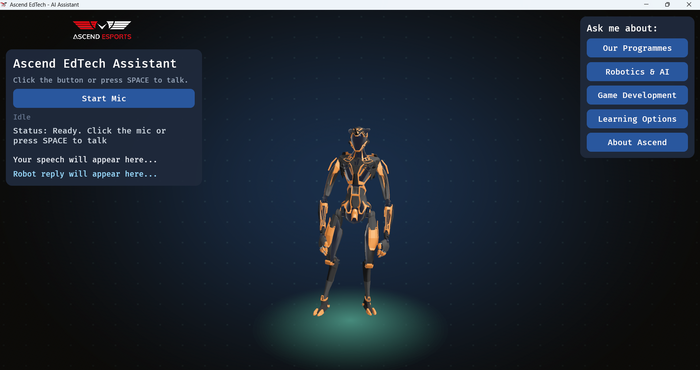

# English Robot Voice Assistant (Rust, Native Desktop)



Press SPACE, speak, and press SPACE again. The robot transcribes you (Whisper), asks your Ollama model `ascend-en`, speaks the answer with `en-GB-RyanNeural`, and plays its talking animations while the voice plays. Drag with the mouse to rotate, and use the mouse wheel to zoom.

## One-time Setup

### 1. Install Rust

- **macOS / Linux**:

  ```bash
  curl --proto '=https' --tlsv1.2 -sSf https://sh.rustup.rs | sh
  ```

- **Windows**: Download and run `rustup-init.exe` from https://rustup.rs/ (and install Visual Studio C++ Build Tools if prompted).

### 2. Install Ollama and Create the Model

- Install Ollama from https://ollama.com/ (or through your package manager).
- Pull the base model:

  ```bash
  ollama pull qwen2.5:1.5b
  ```

- Create the `ascend-en` model from the `Modelfile` inside the `ollama` folder:

  ```bash
  cd ollama
  ollama create ascend-en -f ./Modelfile
  cd ..
  ```

### 3. NVIDIA GPU Acceleration (Optional)

Ollama can automatically use a compatible NVIDIA GPU to accelerate model inference.

**Important:** You normally do not need to install the full CUDA Toolkit to use NVIDIA GPU acceleration with Ollama. A compatible NVIDIA GPU and an up-to-date NVIDIA driver are generally sufficient.

#### Windows

1. Download and install the latest compatible NVIDIA driver:

   https://www.nvidia.com/Download/index.aspx

2. Restart your computer.
3. Open PowerShell and verify that your GPU is detected:

   ```powershell
   nvidia-smi
   ```

#### Linux (Ubuntu / Debian)

1. Install a compatible NVIDIA driver using your distribution's driver manager or NVIDIA's official instructions:

   https://docs.nvidia.com/datacenter/tesla/driver-installation-guide/

2. Restart your computer.
3. Verify GPU detection:

   ```bash
   nvidia-smi
   ```

#### NVIDIA GPU Compatibility

Ollama supports NVIDIA GPUs with compute capability 5.0 or newer. Driver requirements depend on the GPU generation:

- Compute capability 5.0–6.2: NVIDIA driver 570 or newer.
- Other supported GPUs: NVIDIA driver 550 or newer.

Check your GPU's compute capability:

https://developer.nvidia.com/cuda-gpus

#### Verify Ollama GPU Acceleration

1. Start Ollama if it is not already running.
2. Load your model:

   ```bash
   ollama run ascend-en
   ```

3. Send a prompt to the model.
4. Open another terminal and run:

   ```bash
   ollama ps
   ```

5. Check the `PROCESSOR` column:
   - `100% GPU`: Model is running entirely on the GPU.
   - A combination of CPU and GPU: Model is partially offloaded.
   - `100% CPU`: Model is running on the CPU.

6. You can also monitor GPU memory and utilization:

   ```bash
   nvidia-smi
   ```

Run this command while Ollama is generating a response to observe GPU activity.

**Note:** GPU acceleration depends on GPU compatibility and available VRAM. If the model does not fit entirely in GPU memory, Ollama may split processing between the GPU and CPU.

#### Optional: Install the CUDA Toolkit

The full CUDA Toolkit is generally not required just to run Ollama. Install it if you also intend to develop or compile CUDA applications.

Official download:

https://developer.nvidia.com/cuda-downloads

### 4. Expose Ollama

If another machine, container, or service needs access, or if Ollama must bind beyond localhost:

Set `OLLAMA_HOST=0.0.0.0:11434` (and `OLLAMA_ORIGINS=*` if browser/cross-origin clients connect) before starting or restarting the Ollama service.

- **Windows (PowerShell, user environment variable)**:

  ```powershell
  [Environment]::SetEnvironmentVariable("OLLAMA_HOST", "0.0.0.0:11434", "User")
  ```

  Restart the Ollama desktop app or service after setting environment variables.

- **Linux (`systemd` override)**:

  ```bash
  sudo systemctl edit ollama.service
  ```

  Add under `[Service]`:

  ```ini
  [Service]
  Environment="OLLAMA_HOST=0.0.0.0:11434"
  ```

  Then reload and restart:

  ```bash
  sudo systemctl daemon-reload
  sudo systemctl restart ollama
  ```

- **macOS (`launchctl`)**:

  ```bash
  launchctl setenv OLLAMA_HOST "0.0.0.0:11434"
  ```

  Restart Ollama after running this.

**Security note:** Binding to `0.0.0.0` exposes Ollama on network interfaces. Only do this on trusted networks and configure appropriate firewall rules. Avoid exposing the Ollama API directly to the public internet without suitable access controls.

### 5. Install Build Tools for Whisper

`whisper-rs` compiles `whisper.cpp`.

- **CMake**: https://cmake.org/download/ (tick "Add CMake to system PATH").

- **LLVM / libclang** (needed by `bindgen`):

  - **Windows**:

    ```powershell
    winget install LLVM.LLVM
    ```

    Then set `LIBCLANG_PATH` to:

    ```text
    C:\Program Files\LLVM\bin
    ```

  - **Windows** also needs Visual Studio C++ Build Tools (Rust already asked for them).

  - **Linux**:

    ```bash
    sudo apt install build-essential cmake libclang-dev libasound2-dev libudev-dev pkg-config libwayland-dev libxkbcommon-dev
    ```

### 6. Download the Whisper Model

Download `ggml-base.en.bin` from:

https://huggingface.co/ggerganov/whisper.cpp/tree/main

Put the downloaded file inside the `models/` directory.

### 7. Add the Robot Model

Copy `robot.glb` into the `assets/` directory.

## Run

```bash
cargo run --release
```

## Troubleshooting GPU Acceleration

If Ollama does not detect your NVIDIA GPU:

1. Check that the NVIDIA driver is installed correctly:

   ```bash
   nvidia-smi
   ```

2. Make sure you are using a supported NVIDIA GPU.
3. Restart Ollama after installing or updating the driver.
4. Check the Ollama logs for GPU detection errors.

Official Ollama GPU documentation:

https://docs.ollama.com/gpu
